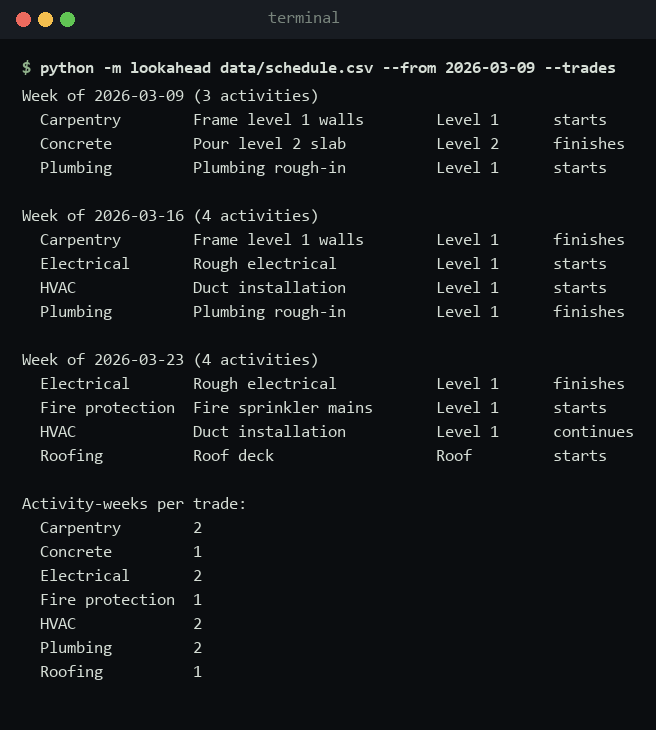

<p align="center"></p>

# lookahead-schedule-generator

Build a three-week lookahead report from a schedule CSV, grouped by week and trade.



## What it is for

A lookahead is the short list of work expected in the next few weeks that a site team reviews in the weekly coordination meeting. Superintendents, project engineers and coordinators build it by hand from the master schedule, which is slow and easy to get wrong. This tool reads the schedule and prints, for each week, which activities start, finish or continue, with the trade and location, so the team can confirm access, materials and crews before the work begins.

## Install

```
git clone <this repo> && cd lookahead-schedule-generator
python -m pip install -r requirements.txt
set PYTHONPATH=src   (Windows)  or  export PYTHONPATH=src
```

Python 3.10 or newer. The tool uses only the standard library; `requirements.txt` lists pytest for the tests.

## How to use

| I want to | Command |
|---|---|
| Three weeks from a date | `python -m lookahead data/schedule.csv --from 2026-03-09` |
| Choose the number of weeks | `python -m lookahead data/schedule.csv --from 2026-03-09 --weeks 4` |
| Add a count per trade | `python -m lookahead data/schedule.csv --from 2026-03-09 --trades` |
| Start from today | `python -m lookahead data/schedule.csv` |

Worked example:

```
$ python -m lookahead data/schedule.csv --from 2026-03-09 --trades
Week of 2026-03-09 (3 activities)
  Carpentry        Frame level 1 walls        Level 1      starts
  Concrete         Pour level 2 slab          Level 2      finishes
  Plumbing         Plumbing rough-in          Level 1      starts

Week of 2026-03-16 (4 activities)
  Carpentry        Frame level 1 walls        Level 1      finishes
  Electrical       Rough electrical           Level 1      starts
  HVAC             Duct installation          Level 1      starts
  Plumbing         Plumbing rough-in          Level 1      finishes

Week of 2026-03-23 (4 activities)
  Electrical       Rough electrical           Level 1      finishes
  Fire protection  Fire sprinkler mains       Level 1      starts
  HVAC             Duct installation          Level 1      continues
  Roofing          Roof deck                  Roof         starts

Activity-weeks per trade:
  Carpentry        2
  Concrete         1
  Electrical       2
  Fire protection  1
  HVAC             2
  Plumbing         2
  Roofing          1
```

## How it works

- `core.load` reads activity, trade, location, start and finish columns and checks the dates.
- The first week begins on the Monday of the date you give. Each week runs Monday to Sunday.
- An activity is listed in every week it overlaps. Its status is starts, finishes, starts and finishes, or continues.
- Rows are sorted by trade, then start date.
- `--trades` counts how many activity-weeks each trade has in the window, a rough view of who is busy.

## Limits

It reads dates as given and does not know holidays or weather. The window is whole weeks. Output is plain text only. The sample file is invented.

## License

MIT. Yassine Emhamed, 2026.
